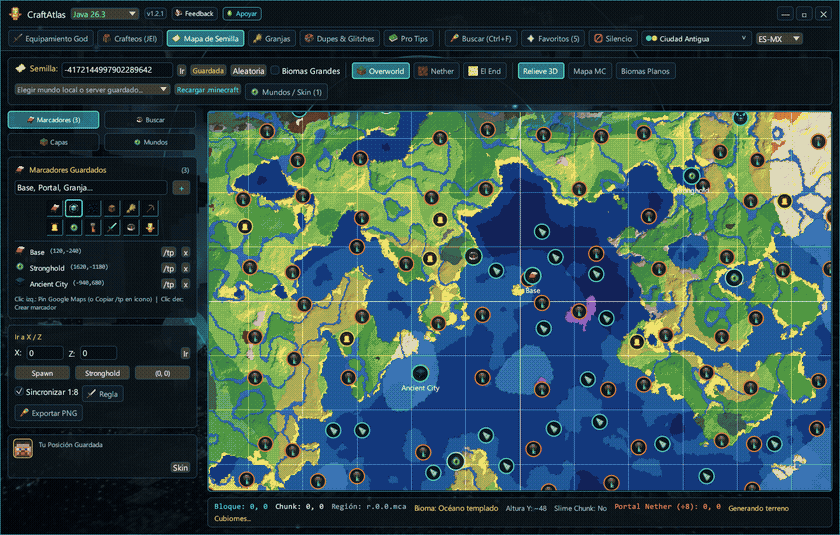
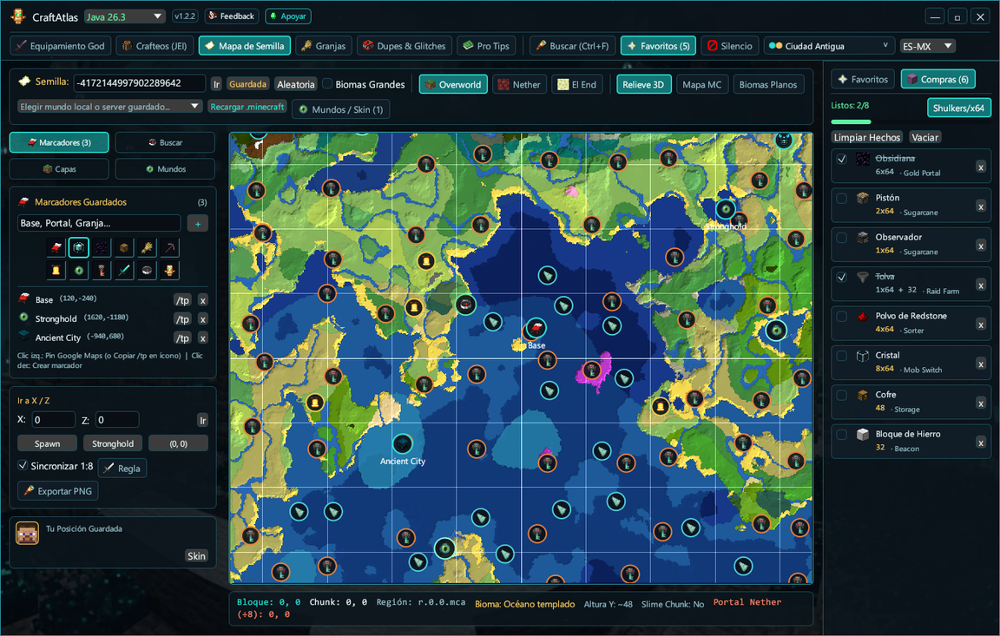
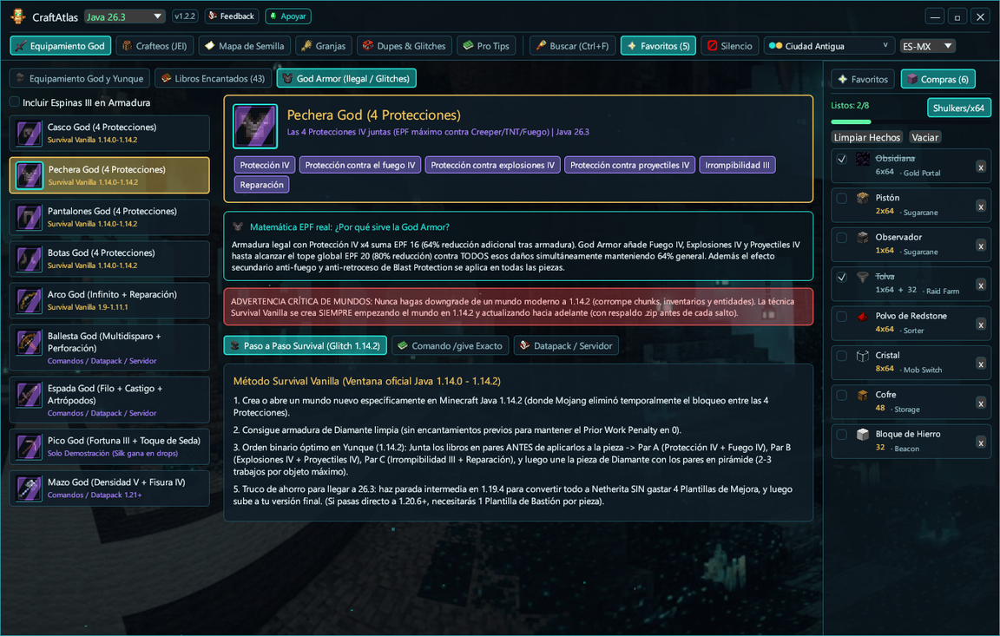
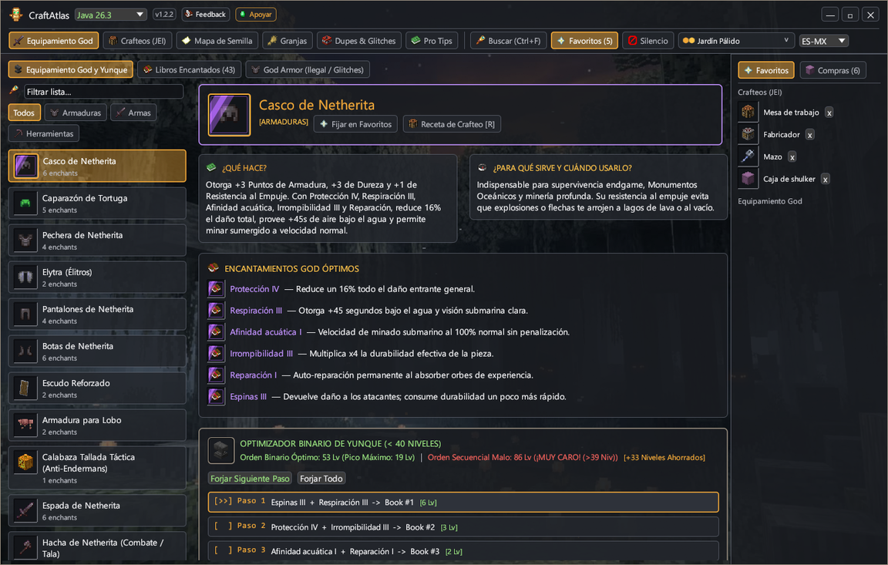
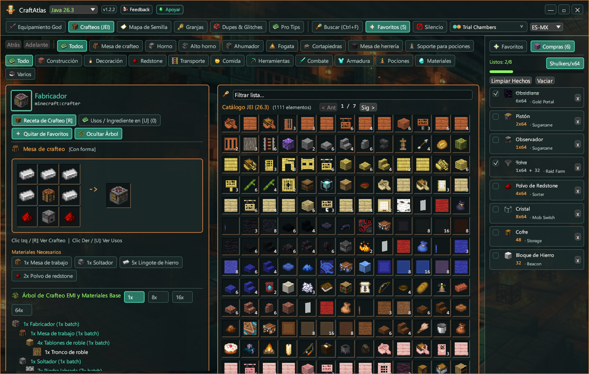
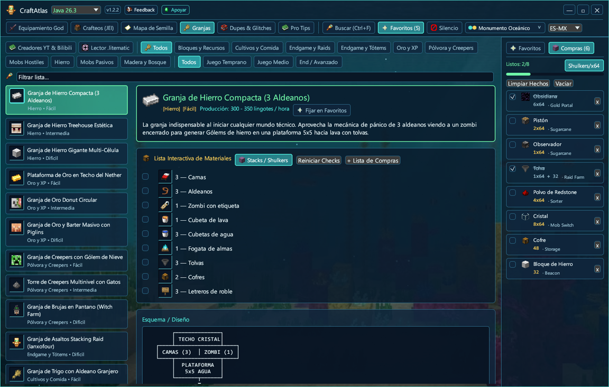
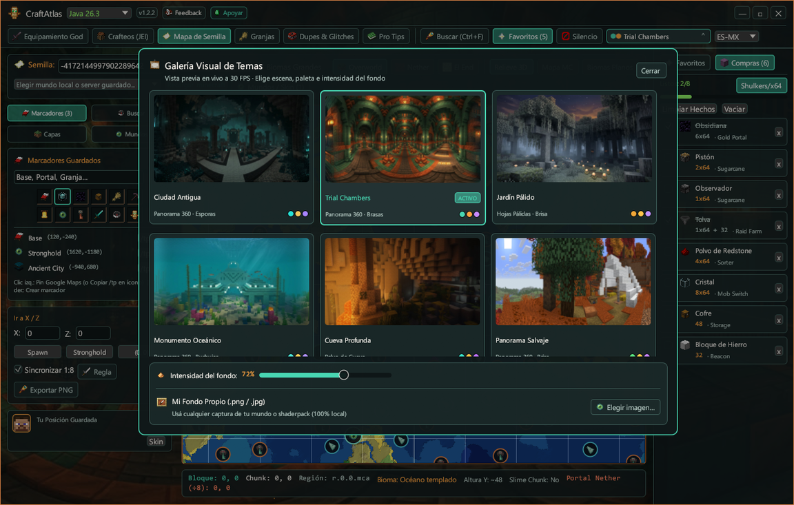

<div align="center">

# CraftAtlas (`v1.2.2`)

**La navaja suiza de escritorio para sobrevivir, optimizar y romper límites en Minecraft Java (`1.18.2` – `26.3`) — nativa en Rust + C, 100% offline y multiplataforma.**

[](https://github.com/Demian1621/CraftAtlas/actions/workflows/ci.yml)
[](https://github.com/Demian1621/CraftAtlas/actions/workflows/release.yml)
[](https://github.com/Demian1621/CraftAtlas/releases/tag/v1.2.2)
[](#-compilar-desde-el-c%C3%B3digo-fuente)
[](#-descarga-e-instalaci%C3%B3n-windows--macos--linux)
[](Cargo.toml)

[Español](#-por-qué-existe-craftatlas) · [English Version](README.en.md) · [Seguridad](SECURITY.md) · [Releases](https://github.com/Demian1621/CraftAtlas/releases) · [Feedback](https://github.com/Demian1621/CraftAtlas/issues/new/choose) · [Apoyar en Ko-fi](https://ko-fi.com/titusdb)

<br/>



</div>

---

## 🎯 ¿Por qué existe CraftAtlas?

Cualquiera que juegue Minecraft técnico o survival avanzado conoce la rutina de tener **14 pestañas abiertas en el navegador** mientras juega: Chunkbase para buscar una Mansión o un Stronghold, la wiki para recordar el orden de encantamientos sin que el yunque te tire *"Demasiado caro"*, JEI o una tabla de alquimia en otra ventana, calculadora de portales 8:1 del Nether en otra, y un bloc de notas con los materiales de la próxima granja.

**CraftAtlas** *(antes llamado Minecraft Companion en `v1.0.0`–`v1.0.2`)* junta todo eso en **una sola app nativa, ligera y sin navegador de por medio**, compilada directamente en **Rust (`eframe`/`egui`)** junto al motor nativo **C (`cubiomes`)**. Abre instantáneamente, no consume RAM como Electron, detecta tus mundos locales de `.minecraft/saves` y te acompaña sin anuncios ni pantallas de carga eternas.

---

## 📸 Galería Visual (`v1.2.2`)

<table>
  <tr>
    <td align="center" width="50%">
      <br/>
      <sub><b>Mapa de Semilla (`cubiomes` C)</b> — Biomas, estructuras, marcadores y búsqueda radial (`1.18.2` – `26.3`)</sub>
    </td>
    <td align="center" width="50%">
      <br/>
      <sub><b>God Armor (Ilegal / Glitches)</b> — 4 Protecciones IV (EPF 20 / 80%), guía `1.14.2`, `/give` y Datapacks</sub>
    </td>
  </tr>
  <tr>
    <td align="center" width="50%">
      <br/>
      <sub><b>Equipamiento God + Yunque Vivo</b> — Orden binario óptimo (&lt; 39 niveles) y Lista de Compras</sub>
    </td>
    <td align="center" width="50%">
      <br/>
      <sub><b>Crafteos JEI / EMI + Alquimia</b> — `2,034` recetas filtradas por versión y árbol recursivo</sub>
    </td>
  </tr>
  <tr>
    <td align="center" colspan="2">
      <br/>
      <sub><b>Granjas Técnicas, Lector `.litematic` y Compras</b> — Shulkers (`x1,728`), checklists y creadores</sub>
    </td>
  </tr>
</table>

<div align="center">

#### 🎨 Galería Visual de Temas + 5 Panoramas 360° Infinitos y 5 Escenas HD
<br/>
<sub><i>Miniaturas 16:9 en vivo, paleta de acentos, intensidad del fondo y fondo propio `.png`/`.jpg` 100% nativo</i></sub>

</div>

---

## 🧭 Qué incluye la v1.2.2

### 1. 🗺️ Mapa de Semilla Nativo Multi-Versión (`cubiomes` C Engine · `1.18.2` – `26.3`)
- **Multi-versión real (`1.18.2`, `1.19.4`, `1.20.6`, `1.21.1`, `1.21.4`, `26.3`):** adaptá biomas, strongholds y estructuras a la versión exacta de tu mundo o servidor SMP desde el selector superior (incluyendo notas por versión, capas y objetivos filtrados para ocultar estructuras/biomas inexistentes en versiones previas).
- **Buscador Radial "Más Cercano" (Estructuras y Biomas):** encontrá en segundo plano los 10 puntos más cercanos de cualquier estructura o bioma (*Mansión, Ciudad Antigua, Stronghold, Monumento, Cámaras de Desafío, Barco Elytra, Campos de Hongos, Arboleda de Cerezos, Jardín Pálido, Oscuridad Profunda, etc.*) ordenados por distancia exacta con botón **`Ir`** y copia de `/tp`.
- **Overworld, Nether y End** con renderizado nativo de biomas, terreno 3D topográfico y **Slime Chunks**.
- **Lectura directa de tus mundos locales (`level.dat`)**: detecta automáticamente carpetas de Minecraft oficial, macOS `Application Support`, Flatpak y **PrismLauncher** (ordenados por último juego) para cargar tu semilla al instante sin escribirla a mano.
- **Semillas guardadas e historial (pensado para Servers):** guardá tus semillas con nombre (por ejemplo servidores SMP que no existen en `.minecraft/saves`) para abrirlas en 1 clic y consultá el historial automático de las últimas 20 semillas exploradas.
- **Última posición guardada y skin personalizada (`.png`)**: muestra en el mapa la última posición guardada del jugador (`Player.Pos` + dimensión) aclarando explícitamente que es la última posición guardada (no en vivo), con botón de recarga y carga de tu archivo de skin `.png` (`64x64`, `64x32` o HD) para mostrar tu cara real en el mapa.
- **Escaneo inteligente por prioridad de estructuras**: Strongholds, **Mansiones del Bosque** (incluyendo biomas `dark_forest` y `pale_garden` de Java 26.3), Monumentos Oceánicos, **Ciudades Antiguas (ícono de cabeza de Warden)**, Trial Chambers, Bastiones, Fortalezas y End Cities con Barco.
- **Sincronización Overworld ↔ Nether (8:1)**, herramienta **Regla** para medir bloques exactos, **marcadores (waypoints) personalizados** (con ícono de cama roja clásica para `Casa / Cama`), pin temporal con copia instantánea de comando `/tp` (click derecho en cualquier coordenada) y **exportación a PNG**.

### 2. ⚒️ Equipamiento God, God Armor Ilegal y Libros Encantados (29 presets · 43 libros)
- Configuraciones completas de armadura, herramientas, armas (incluyendo **Lanza / Estocada**) y élitros con filtrado estricto por versión (sin *Sigilo Rápido* en `1.18.2`, sin *Brocha/Lobo* antes de `1.20.6`, sin *Maza* antes de `1.21.1`).
- **Nueva vista `God Armor (Ilegal / Glitches)`:** guía paso a paso para armar sets con las **4 Protecciones IV simultáneas** (tope **EPF 20 / 80% reducción**), Arco *Mending + Infinity* (`1.9–1.11.1`), Espada triple daño, Ballesta doble y Mazo ilegal (`1.21.1+`), cubriendo ruta Survival Vanilla desde `1.14.2` hacia adelante (con alerta anti-downgrade), pirámide binaria de yunque, **comandos `/give` exactos adaptados a cada versión** (`{Enchantments}` NBT vs `levels:{}` vs `26.3`) y **Datapack JSON (`#exclusive_set`)**.
- **Guía de Libros Encantados conmutada**: hasta **43 encantamientos oficiales de Minecraft Java** filtrados según la versión seleccionada (`38` en `1.18.2` → `43` en `26.3`), sus fuentes, incompatibilidades e ítems compatibles filtrados por versión.
- **Optimizador matemático real de Yunque Java**: calcula el **árbol de fusión óptimo** frente al orden ingenuo paso a paso para ahorrar niveles de XP y **no superar nunca el tope de 39 niveles ("Demasiado caro")**.
- Incluye simulación interactiva **Yunque Vivo** paso a paso para forjar tu pieza sin equivocarte.

### 3. 📖 Crafteos JEI / EMI + Alquimia Completa (2,034 recetas por versión)
- Buscador instantáneo estilo **JEI / EMI** (`Crafteos` y `Usos`) estrictamente filtrado por la versión activa de Minecraft Java (incluyendo **Herrería Netherita de 2 slots sin plantilla en `1.18.2–1.19.4`**, Magnetita con Netherita y Rienda con Slime antes de `26.3`, y sin ítems modernos en versiones viejas).
- Cubre mesa de crafteo, horno, alto horno, ahumador, herrería, cortapiedras y **Mesa de Alquimia** con pociones adaptadas por versión (`15` base en `<=1.20.6`, `19` con Trial Potions en `1.21.1+`).

### 4. 🌾 Granjas Técnicas, Lector `.litematic` y Lista de Compras (113 granjas · 31 creadores)
- Filtrables por etapa (`Early`, `Mid`, `End Game`) y categoría, con **compatibilidad estricta por versión** (oculta granjas de *Crafter/Trial/Resin/Armadillo* en versiones previas y adapta *Stacking Raid Farm*, *Brujas* y *Bambú* según la versión activa).
- **Lector nativo de archivos `.litematic` (Litematica):** abrí cualquier `.litematic` desde `.minecraft/schematics` o arrastrándolo a la ventana para ver el desglose real de bloques (incluyendo losas dobles), filtros y conteo en **Shulkers (`x1,728`) + Stacks (`x64`)**.
- **Lista de Compras Unificada (Shulkers + Progreso):** enviá materiales con 1 clic desde **Granjas**, **Árboles JEI** o **`.litematic`** al panel derecho persistente con barra de progreso y checklist.
- Botón inteligente de búsqueda en YouTube que adapta automáticamente idioma y versión activa de Minecraft, acompañado de un directorio curado de **31 creadores técnicos** de habla hispana, inglesa y china con sus caras reales de skin y etiquetas de especialidad (`Granjas`, `Dupes/Exploits`, `Redstone`).

### 5. ⚡ Dupes, Glitches y Calculadora de Portales (34 mecánicas por versión)
- Fichas técnicas dinámicas por versión: muestra el estado real en cada versión (*String Duper* activo en `1.18.2–1.21.1` vs parcheado en `1.21.4+`; *Void Trading* activo hasta `1.20.6` vs parcheado en `1.21.1+`; *Supresor StackOverflow* nativo en `1.18.2` vs CCE/Light en `1.19.4+`; *Curación x5* hasta `1.19.4` vs límite `1x` desde `1.20.2+`), junto a la **calculadora instantánea de enlace de portales Overworld ↔ Nether**.

### 6. 💡 Pro Tips y Galería Visual de Temas (17 guías · 10 temas + Fondo Propio · 3 idiomas)
- **2,308 íconos** empaquetados en atlas de alta nitidez (sin borrosidad), audio sintetizado desactivable, **Galería Visual de Temas** con miniaturas `16:9` en vivo, control de **intensidad del fondo** y **10 temas integrados**: **5 panoramas 360° infinitos sin costura (`2048×640`)** (*Ciudad Antigua*, *Trial Chambers*, *Monumento Oceánico*, *Panorama Salvaje*, *Nether Carmesí*) y **5 escenas HD con partículas sutiles estilo Minecraft** (*Jardín Pálido* con hojas cayendo, *Cerezo Atardecer* con pétalos, *Cueva Profunda*, *Aurora del End*, *Noche Estrellada*), más **Fondo Propio (`.png`/`.jpg`)** 100% nativo en Rust con pausa automática (`0%` CPU) en segundo plano.
- Buscador universal **`Ctrl + F`**, barra de **Favoritos**, idiomas **`ES-MX`**, **`ES-ES`** y **`EN-US`**, y **auto-updater verificado por SHA-256** desde GitHub Releases.

---

## 💻 Descarga e Instalación (Windows · macOS · Linux)

Descarga el instalador o ejecutable de tu sistema desde la sección de **[Releases](https://github.com/Demian1621/CraftAtlas/releases)**:

### 🪟 Windows (x86_64)
- **`.exe` directo**: doble clic y listo (portable, no requiere instalación).
- **`.zip`**: descomprime y ejecuta `craft-atlas.exe`.

### 🍎 macOS (Universal: Apple Silicon M1/M2/M3/M4 + Intel)
1. Descarga **`craft-atlas-v1.2.2-macos-universal.dmg`** (o el `.zip`).
2. Arrastra **CraftAtlas.app** a tu carpeta **Aplicaciones**.
3. **Nota de primera apertura (Gatekeeper)**: como esta release aún no cuenta con firma paga de Apple Developer, haz **clic derecho (o Ctrl + clic) → Abrir → Abrir**, o ejecuta una sola vez en Terminal:
   ```bash
   xattr -cr "/Applications/CraftAtlas.app"
   ```

### 🐧 Linux (Todas las distros)
| Formato | Distros recomendadas | Cómo usar |
| --- | --- | --- |
| **`.AppImage`** *(Universal)* | Ubuntu, Fedora, Arch, Mint, Pop!_OS, openSUSE, SteamOS | `chmod +x craft-atlas-v1.2.2-linux-x86_64.AppImage && ./craft-atlas-v1.2.2-linux-x86_64.AppImage` |
| **`.deb`** | Ubuntu, Debian, Linux Mint, Pop!_OS, Zorin | `sudo apt install ./craft-atlas_1.2.2_amd64.deb` |
| **`.rpm`** | Fedora, RHEL, Rocky, openSUSE | `sudo dnf install ./craft-atlas-1.2.2-1.x86_64.rpm` |
| **`.tar.gz`** *(Portable)* | Arch Linux, Manjaro, NixOS, genérico | Extrae y ejecuta `./craft-atlas` o `./install-user.sh` |

> **Verificación SHA-256 y Build Provenance**: cada Release incluye `SHA256SUMS.txt` y atestación criptográfica oficial de GitHub Actions (ver [SECURITY.md](SECURITY.md)).

---

## 🛠️ Compilar desde el código fuente

Requiere **Rust (`cargo` / `rustc` estables)** y compilador C (`gcc` / `clang` / MSVC) para compilar `cubiomes`:

```bash
# En Linux (Ubuntu/Debian) instala primero dependencias de sistema:
sudo apt-get install -y build-essential pkg-config libasound2-dev \
  libxkbcommon-dev libwayland-dev libgl1-mesa-dev libxcursor-dev \
  libxrandr-dev libxi-dev libx11-dev libxcb-render0-dev libxcb-shape0-dev libxcb-xfixes0-dev

# Compilar y ejecutar pruebas:
cargo test --locked
cargo build --release --locked
```

---

## ⚡ Novedades de `v1.2.2`

- **5 Panoramas 360° Infinitos Sin Costura (`2048×640`) + Partículas Limpias:** *Ciudad Antigua*, *Trial Chambers* y *Monumento Oceánico* ahora giran suavemente en 360° como el menú principal de Minecraft (junto a *Panorama Salvaje* y *Nether Carmesí*), mientras *Jardín Pálido* incorpora hojas pálidas cayendo suavemente como *Cerezo Atardecer* — sin círculos parpadeantes ni haces falsos encima.
- **Galería Visual de Temas + Intensidad + Fondo Propio (`.png` / `.jpg` nativo):** selector visual con miniaturas `16:9`, muestras de paleta, vista previa en vivo, slider de brillo del fondo y carga local de capturas propias (sin FFmpeg).
- **Soporte Multi-Versión (`1.18.2` → `26.3`) + God Armor Ilegal + `.litematic` + Updater SHA-256:** ver notas completas en [RELEASE_v1.2.2.md](docs/RELEASE_v1.2.2.md) (y notas previas en [RELEASE_v1.2.2.md](docs/RELEASE_v1.2.2.md)).

---

## 💬 Feedback y apoyo al proyecto

CraftAtlas es **100% gratis, sin anuncios y sin funciones bloqueadas detrás de pagos**. Todo está disponible desde el primer día.

- **¿Encontraste un bug o querés proponer una idea?** Abrí un reporte o sugerencia desde [GitHub Issues](https://github.com/Demian1621/CraftAtlas/issues/new/choose) o sumate a las [GitHub Discussions](https://github.com/Demian1621/CraftAtlas/discussions).
- **¿Te ahorró tiempo y querés invitar un café? (Opcional):** Podés apoyar el proyecto en [Ko-fi (`https://ko-fi.com/titusdb`)](https://ko-fi.com/titusdb) o usar el botón **Apoyar** en la barra superior de la app.

---

## 🚀 Actualizaciones automáticas y seguridad

CraftAtlas `v1.2.2` incluye **comprobación y actualización in-app verificada por SHA-256 (FIPS 180-4)** vía HTTPS `TLS 1.2+` contra **GitHub Releases**, junto con **Build Provenance Attestations** firmadas por GitHub Actions en cada ejecutable publicado.

---

<div align="center">
Hecho con Rust, C y pasión por el survival técnico · <b>Demian1621</b>
</div>
